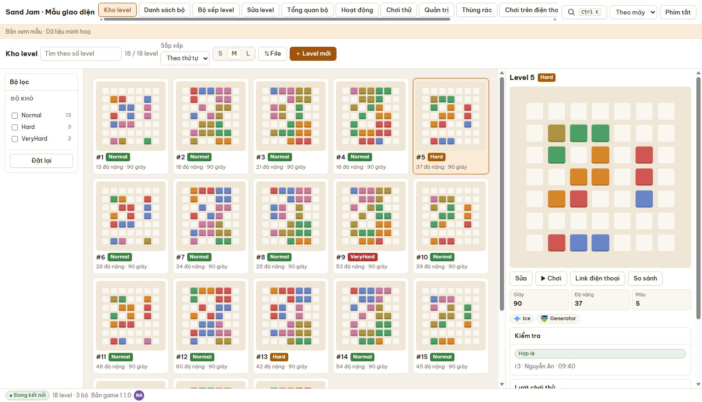
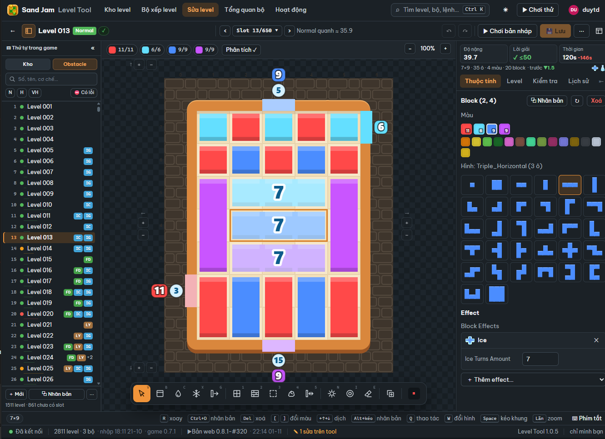
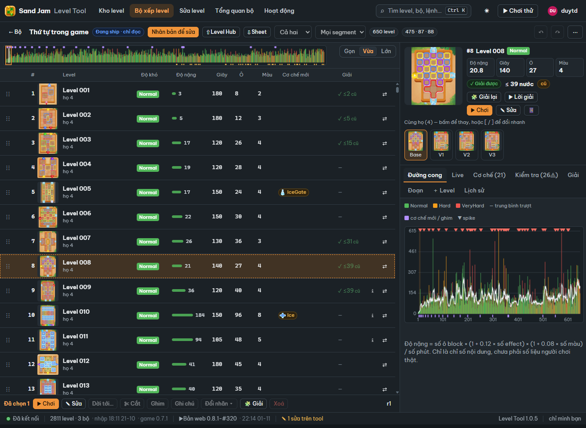
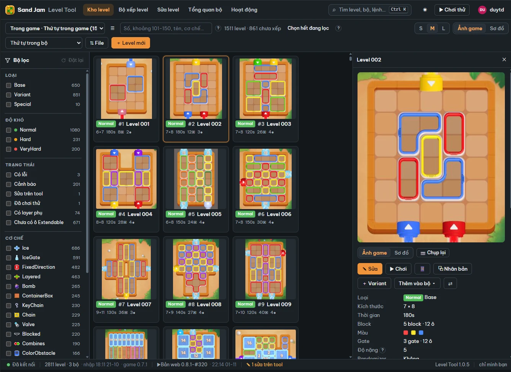
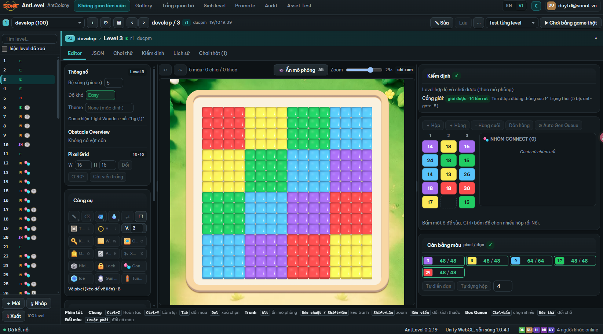
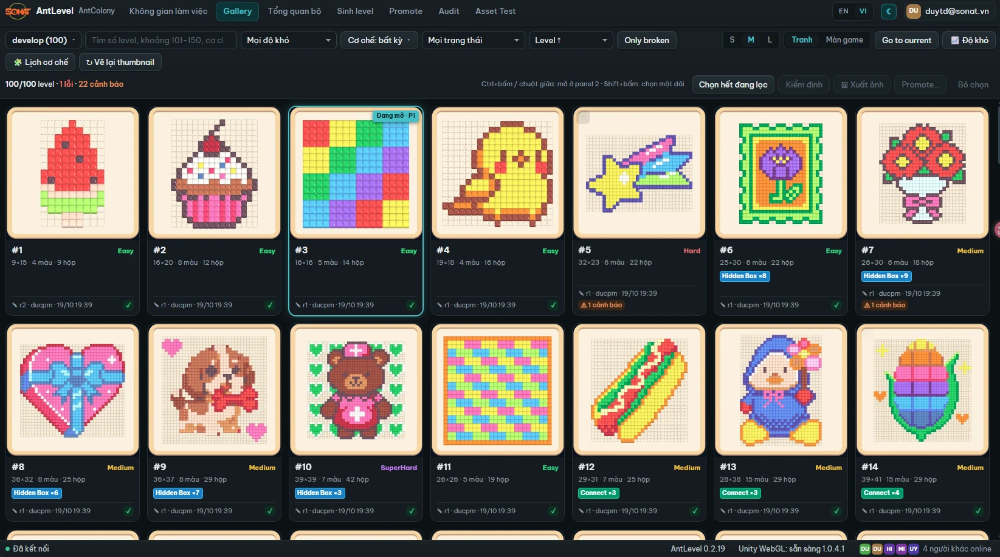
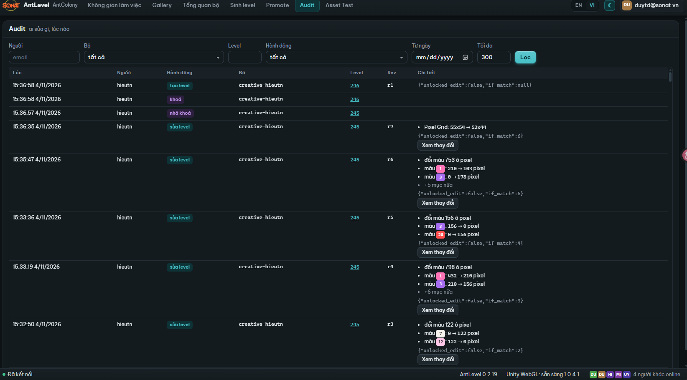

# level-tool-core

Base logic for all level tools — phần chung của mọi tool level của Sonat. Mỗi game có một tool riêng chạy trên BI tại
`https://<slug>.tools.sonatgame.com`: GD / Creative xếp level, sửa level, chơi thử bằng bản WebGL của game, xem số liệu,
đẩy bộ level lên BI Level Hub.

Mỗi game **fork** repo này và chỉ thêm phần riêng ở `game/` (manifest, luật level, test, hook giao diện tuỳ chọn);
`levelcore/` là của core, game không sửa.

## Kho mẫu giao diện

Mỗi tool có thể chọn một mẫu cho vỏ Core và dùng lại các bố cục, popup, thành phần UI của mẫu trong màn riêng.

### Sand Jam (`sand-jam`)

Giao diện tông cát–cam, có chế độ sáng và tối. Bộ mẫu gồm 12 bố cục, 36 ví dụ popup tương tác và bộ điều khiển cho
Kho level, Bộ xếp level, editor và khung Chơi thử.

[](levelcore/docs/UI-TEMPLATE-SAND-JAM.md)

[Xem ảnh và chi tiết mẫu Sand Jam](levelcore/docs/UI-TEMPLATE-SAND-JAM.md) · [Chọn hoặc thêm mẫu](levelcore/docs/UI-TEMPLATES.md)

## Tool đang chạy

Vỏ giao diện của core theo bố cục hai tool đang dùng: các màn ở hàng trên, bộ đang mở và công cụ của màn ở hàng thứ hai,
thanh trạng thái (kết nối, bản game, người online) ở đáy, tìm nhanh Ctrl+K.

### Sand Jam — https://sandjam.tools.sonatgame.com/

| Sửa level | Bộ xếp level |
| --- | --- |
|  |  |



Từng màn của Sand Jam có gì, ảnh đánh số và phần nào core đã có: [levelcore/docs/SANDJAM-TINH-NANG.md](levelcore/docs/SANDJAM-TINH-NANG.md).

### Antopia — https://antopia.tools.sonatgame.com/

| Không gian làm việc | Gallery |
| --- | --- |
|  |  |



## Tài liệu

| Đọc khi | File |
| --- | --- |
| **Làm tool cho game mới**: đủ các bước repo tool, Unity (bản WebGL, bridge), Jenkins, BI, Level Hub, kèm link tài liệu CI/CD và BI | [levelcore/docs/TICH-HOP-GAME.md](levelcore/docs/TICH-HOP-GAME.md) |
| Chọn mẫu giao diện dùng chung cho tool hoặc đóng góp mẫu mới | [Kho mẫu giao diện](levelcore/docs/UI-TEMPLATES.md) |
| Muốn biết một tool hoàn chỉnh có gì: tính năng từng màn của Sand Jam, ảnh đánh số, đánh dấu phần core đã có / game tự làm | [levelcore/docs/SANDJAM-TINH-NANG.md](levelcore/docs/SANDJAM-TINH-NANG.md) |
| Quy tắc cho người và AI agent làm tool (chỗ được sửa, chạy, test, giao diện, changelog) | [levelcore/AGENTS.md](levelcore/AGENTS.md) |
| Core có gì, biến môi trường, hook giao diện, nâng core | [levelcore/README.md](levelcore/README.md) |
| Hợp đồng của hai server: route, manifest, module luật, bridge WebGL, CI v1 | [levelcore/contracts/README.md](levelcore/contracts/README.md) |
| Tạo repo tool, lấy bản mới của core, đóng góp về core | [levelcore/FORK.md](levelcore/FORK.md) |
| Thay đổi của core (mục Cần chú ý = bước bắt buộc khi nâng) | [levelcore/CHANGELOG.md](levelcore/CHANGELOG.md) |

Game cũ khai bằng plugin Python (vẫn chạy trên core): HoleLevel (`SonatGameProduct/frenzy-hole-level-tool`).

Với Claude Code: mở repo tool vừa fork và dùng skill `levelcore-new-game` (`.claude/skills/`), rồi các skill `bi-*` để
đưa lên BI.

## Bắt đầu nhanh

```sh
git clone git@github.com:SonatGameProduct/level-tool-core.git <game>-level-tool && cd <game>-level-tool
git remote rename origin core
node levelcore/tools/new_game.mjs --tool FishLevel --game "Fish Sort" --prefix FISHLEVEL --slug fishsort --raw <thư mục raw>
node --test game/tests/*.test.mjs
ChayDev.bat
```

Cần Node ≥ 22.13 (server Node, mặc định); server Python thì thêm Python 3.10+.

## Test của core

```sh
node levelcore/contracts/run.mjs                    # hợp đồng chung, chạy với server Python rồi Node
node --test levelcore/node/tests/*.test.mjs         # riêng server Node
py -m venv .venv && .venv/Scripts/python -m pip install -r levelcore/server/requirements-dev.txt
cd levelcore/server && ../../.venv/Scripts/python -m pytest
```
