# Sand Jam Level Tool: tính năng theo từng màn

Sand Jam Level Tool là tool level đầy đủ nhất đang chạy: https://sandjam.tools.sonatgame.com, repo
[`SonatGameProduct/sand-jam-level-tool`](https://github.com/SonatGameProduct/sand-jam-level-tool), bản 1.0.5 (04/11/2026).
Tài liệu này liệt kê tính năng theo từng màn, kèm ảnh có đánh số, để dev làm tool cho game khác biết một tool hoàn chỉnh có
gì và core đã có tới đâu.

Ảnh có đánh số chụp bản chạy local với dữ liệu thử (2811 level, 3 bộ), không phải số liệu production. Ảnh tổng thể Level
Hub là ảnh Sand Jam do người dùng cung cấp ngày 05/11/2026, không phải giao diện core. Repo Sand Jam có cùng tài liệu
ở [`docs/TINH-NANG.md`](https://github.com/SonatGameProduct/sand-jam-level-tool/blob/main/docs/TINH-NANG.md); sửa thì sửa cả hai.

**Cột Core** so với core ngày 04/11/2026 ([Có gì trong core](../README.md#có-gì-trong-core)):

| Ký hiệu | Nghĩa |
| --- | --- |
| ✅ | core có sẵn (vỏ app, hoặc server Node) |
| 🔌 | core có khung, game viết phần riêng qua manifest / hook (`fields`, `levelSummary`, `listFilters`, `listItem`, `levelDetail`, `renderEditor`, `thumbnail`, `validateLevel`) hoặc qua bridge WebGL |
| ➕ | chỉ Sand Jam có: game tự làm, hoặc lấy từ repo Sand Jam rồi đóng góp về core ([FORK.md](../FORK.md)) |

## Mục lục

1. [Bố cục chung](#1-bố-cục-chung)
2. [Kho level](#2-kho-level)
3. [Bộ xếp level](#3-bộ-xếp-level)
4. [Sửa level](#4-sửa-level)
5. [Tổng quan bộ](#5-tổng-quan-bộ)
6. [Hoạt động](#6-hoạt-động)
7. [Chơi thử](#7-chơi-thử)
8. [Quản trị và Thùng rác](#8-quản-trị-và-thùng-rác)
9. [Chạy ngầm, không có màn riêng](#9-chạy-ngầm-không-có-màn-riêng)
10. [Gợi ý cho game mới](#10-gợi-ý-cho-game-mới)

## 1. Bố cục chung

Sáu vùng (slide giới thiệu Level Tools của BI): menu và bộ level, danh sách level, thông số và công cụ, bản chơi, panel
kiểm định, giả lập (game WebGL, tách ra cửa sổ riêng được). Các panel sắp xếp lại được.

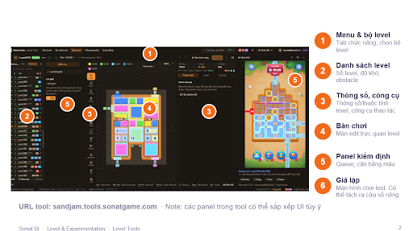

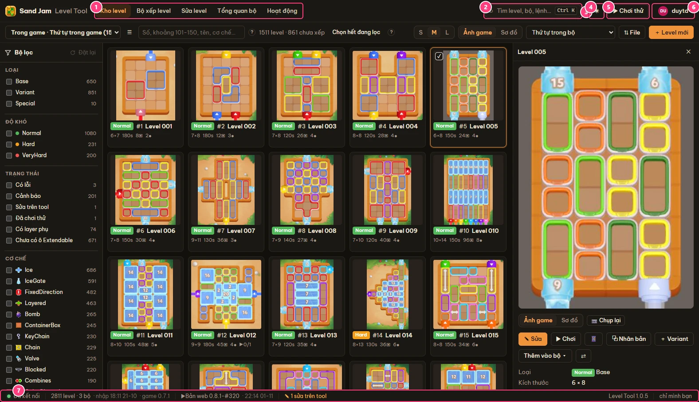

| # | Tính năng | Core |
| --- | --- | --- |
| 1 | Các màn: Kho level, Bộ xếp level, Sửa level (mở lại level sửa gần nhất), Tổng quan bộ, Hoạt động. Quản trị và Thùng rác nằm ở menu tài khoản. | ✅ |
| 2 | Tìm nhanh `Ctrl+K` hoặc `/`: level, bộ, trang, lệnh. `Enter` mở ở Kho level, `Shift+Enter` mở editor (bộ: mở Tổng quan), `Ctrl+Enter` chơi ngay. | ✅ |
| 3 | Người đang online, bấm để sang Hoạt động. | ✅ |
| 4 | Giao diện sáng / tối / theo máy (`T`), lưu trên trình duyệt. | ✅ |
| 5 | Bảng Chơi thử (`P`): game WebGL nhúng cạnh màn đang làm, có chấm khi game đang chạy. | ✅ |
| 6 | Menu tài khoản: đổi tên, Cài đặt, Phím tắt, Quản trị, Thùng rác, Có gì mới. Token API cho dev (Pull về Unity, script). | ✅ · token ➕ |
| 7 | Thanh trạng thái: kết nối, số level / bộ, lần nhập dữ liệu game, bản web đang dùng, tiến độ chụp ảnh / giải level, số level sửa trên tool chưa về repo game, phiên bản tool. | ✅ · tiến độ giải, "sửa trên tool" ➕ |

| Tìm nhanh và menu tài khoản | Có gì mới |
| --- | --- |
| 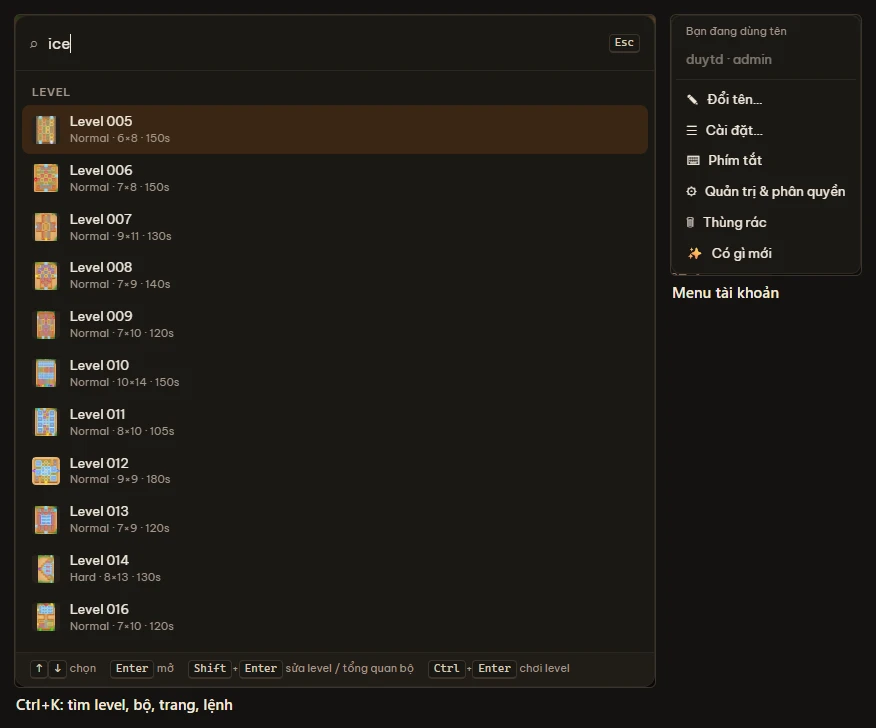 | 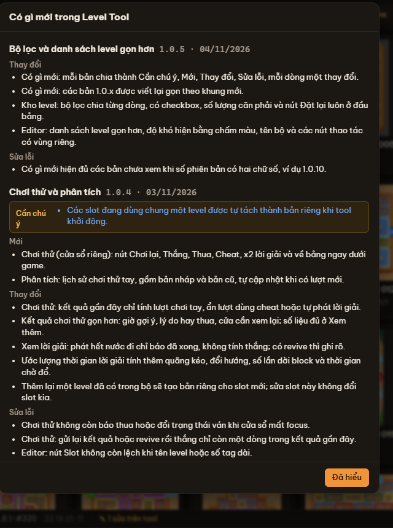 |

- **Phím tắt** (`?`): đổi phím từng lệnh, gán được nút chuột bên hông, lưu trên trình duyệt. ✅
- **Có gì mới**: tự hiện các bản chưa xem, chia Cần chú ý / Mới / Thay đổi / Sửa lỗi. ✅
- **Realtime**: level, bộ, khoá sửa, người online cập nhật qua SSE; mất mạng nối lại thì tự cập nhật. ✅
- Nút **?** cạnh các chỉ số giải thích cách tính. ➕

| Bảng phím tắt | Giao diện sáng |
| --- | --- |
| 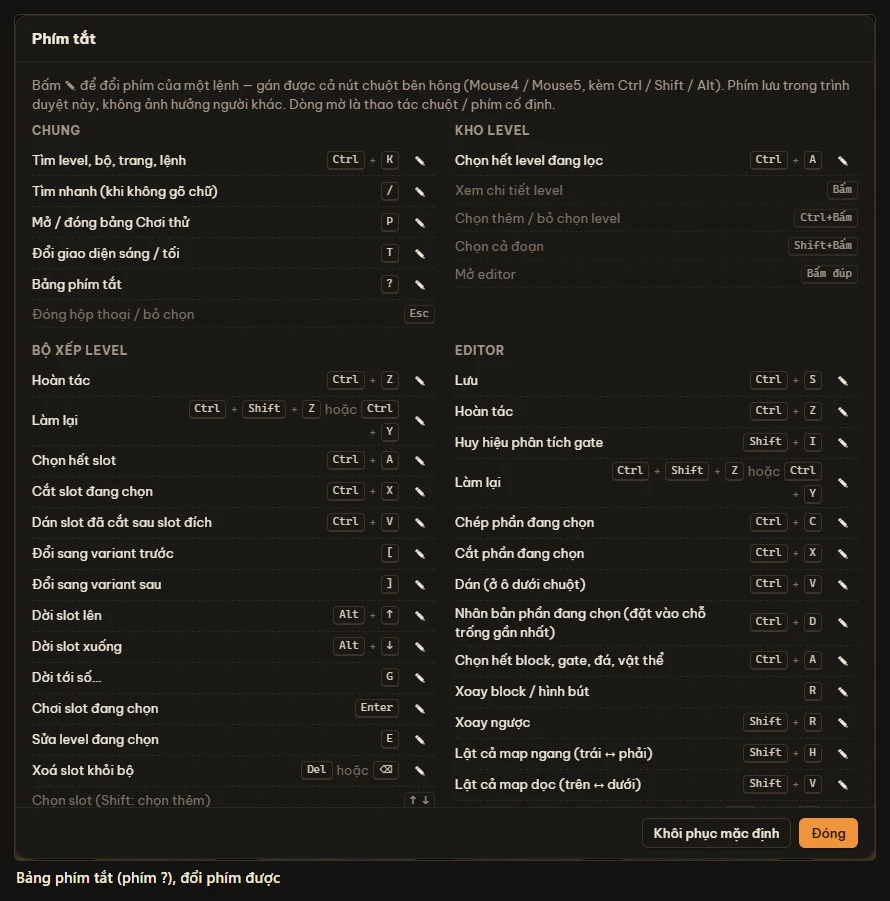 | 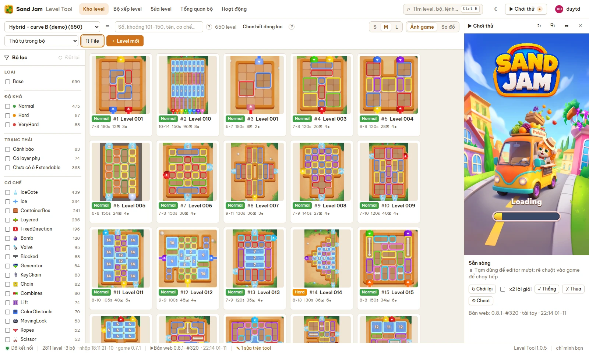 |

## 2. Kho level

Lưới level của một bộ: tìm, lọc, xem ảnh, chọn nhiều để thao tác.

| # | Tính năng | Core |
| --- | --- | --- |
| 1 | Chọn bộ đang xem (nhớ bộ lần trước); trình duyệt chỉ tải level của bộ đó. `#` là slot trong bộ, level chưa có slot ghi "chưa xếp". | ✅ |
| 2 | Tìm theo số `12`, khoảng `101-150`, danh sách `5, 9, 12`, tên, cơ chế. | ✅ · cơ chế 🔌 |
| 3 | Chọn hết level đang lọc. | ✅ |
| 4 | Cỡ thẻ S / M / L; xem bằng ảnh game hoặc sơ đồ (vẽ từ dữ liệu, icon obstacle lấy từ sprite của game, số lượt / số giây ngay trên obstacle). | ✅ · sơ đồ 🔌 `thumbnail` |
| 5 | Sắp xếp: thứ tự trong bộ, độ nặng, số ô block, thời gian, sửa gần nhất, nhiều lỗi trước, thắng lần đầu và rơi rụng của người chơi thật. | ➕ |
| 6 | ⇅ File: nhập / xuất ZIP, JSON, group Level Hub, zip file `.asset` của Unity (thêm vào cuối hoặc thay cả bộ). ＋ Level mới. | ✅ · `.asset` ➕ |
| 7 | Bộ lọc theo dòng có checkbox và số lượng: loại (Base / Variant / Special), độ khó, trạng thái (có lỗi, cảnh báo, sửa trên tool, đã chơi thử, có layer phụ, chưa có ô Extendable), cơ chế; nút Đặt lại. | 🔌 `listFilters` |
| 8 | Thẻ level: ảnh, nhãn độ khó, slot, tên, kích thước · giây · số ô · số màu; 🔒 khi người khác đang sửa. Ctrl / Shift + bấm chọn nhiều, bấm đúp mở editor. | ✅ · dòng phụ 🔌 `listItem` |
| 9 | Ngăn chi tiết level, xem [mục dưới](#chi-tiết-level). | |

| Tạo và nhập level | Chọn nhiều level |
| --- | --- |
| 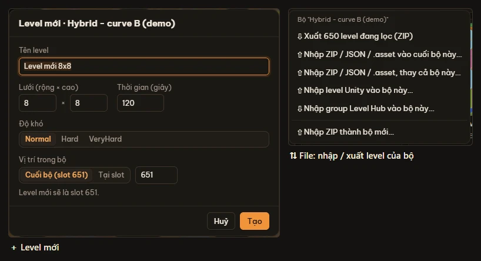 | 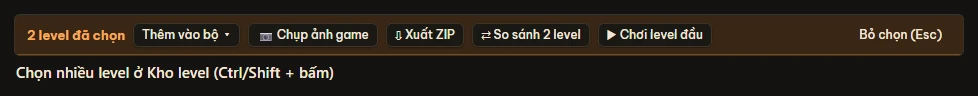 |

- **＋ Level mới**: chọn tên, độ khó, thời gian, vị trí trong bộ. 🔌 `blankLevel`
- **Chọn nhiều**: Thêm vào bộ, Chụp ảnh game, Xuất ZIP, So sánh 2 level, Chơi level đầu, Bỏ chọn (`Esc`). ✅ chọn nhiều,
  chụp ảnh · các nút còn lại ➕

### Chi tiết level

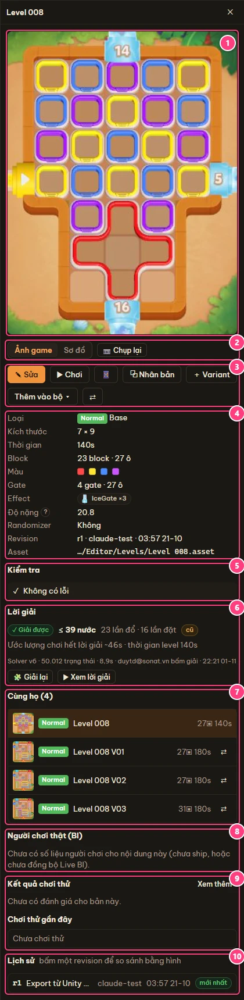

| # | Tính năng | Core |
| --- | --- | --- |
| 1 | Ảnh game lớn (1024px) do chính bản WebGL chụp. | ✅ · cần bridge chụp |
| 2 | Đổi Ảnh game / Sơ đồ, 📷 Chụp lại. | ✅ · sơ đồ 🔌 |
| 3 | ✎ Sửa, ▶ Chơi, 📱 link điện thoại (QR, không cần đăng nhập, hết hạn 14 ngày), ⧉ Nhân bản, ＋ Variant, Thêm vào bộ, ⇄ so sánh với level khác. | ✅ · Variant, so sánh ➕ |
| 4 | Thông số: loại, kích thước, thời gian, block, màu, gate, effect, độ nặng, randomizer, revision, asset trong repo game. | 🔌 `levelDetail` |
| 5 | Kiểm tra: lỗi và cảnh báo của validator. | 🔌 `validateLevel` |
| 6 | Lời giải: kết quả solver (giải được ≤ N nước, số lần đổ / đặt, kết quả cũ), ước lượng thời gian chơi hết lời giải, 🧩 Giải lại, ▶ Xem lời giải (game tự chơi). | ➕ |
| 7 | Cùng họ: Base và các Variant; ⇄ để thay level ở slot bằng variant. | ➕ |
| 8 | Người chơi thật (BI): số liệu Live BI gắn theo nội dung level. | ➕ |
| 9 | Kết quả chơi thử (giờ gợi ý, lý do hay thua, gate cần xem lại) và các lượt chơi thử gần đây, ▶ phát lại đúng lượt. | ✅ lưu lượt · phân tích ➕ |
| 10 | Lịch sử revision; bấm một revision để so sánh bằng hình, khôi phục. | ✅ · so bằng hình ➕ |

**So sánh 2 level**: ảnh hai bên, bảng thông số tô vàng chỗ khác nhau. ➕

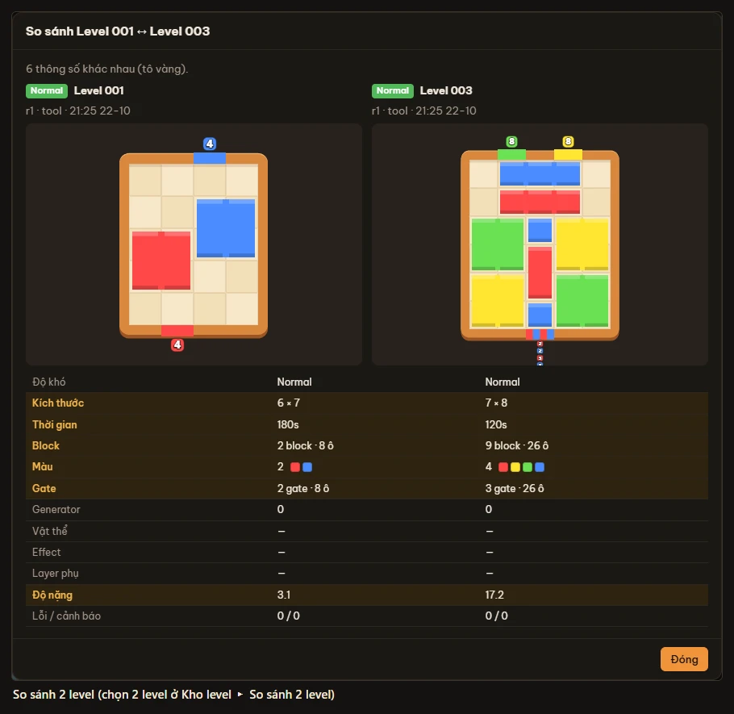

## 3. Bộ xếp level

Mỗi bộ là một thứ tự level cho một nền tảng × segment. Nhiều GD cùng sửa một bộ.

### Danh sách bộ

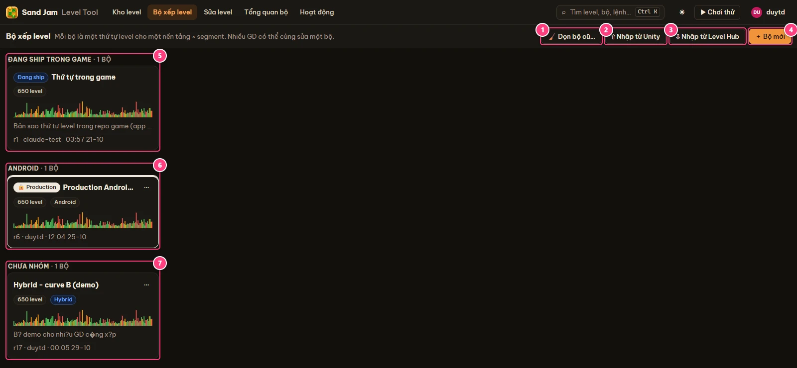

| # | Tính năng | Core |
| --- | --- | --- |
| 1 | 🧹 Dọn bộ cũ: liệt kê bộ nháp lâu không ai sửa, chọn để lưu trữ một lượt (ghi lý do). | ➕ |
| 2 | ⇧ Nhập từ Unity: tạo bộ từ zip các file level `.asset`. | ➕ |
| 3 | ⇩ Nhập từ Level Hub: tải một group trên BI thành bộ mới, level trùng nội dung được dùng lại. | ✅ |
| 4 | ＋ Bộ mới. | ✅ |
| 5 | Bộ "Trong game": thứ tự level của bản game đang ship, chỉ đọc; lấy từ CI hoặc hỏi thẳng bản web đang dùng. Muốn sửa thì "Nhân bản để sửa". | ✅ CI · lấy từ bản web ➕ |
| 6 | Bộ production theo nền tảng: ghim revision ở từng slot, chỉ nhận level qua Promote. | ✅ |
| 7 | Bộ nháp theo nhóm, nền tảng, segment; thẻ có đường cong mini, revision, người sửa cuối; ⋯ đổi tên, nhân bản, đặt nhóm, lưu trữ. | ✅ · đường cong mini ➕ |

### Một bộ

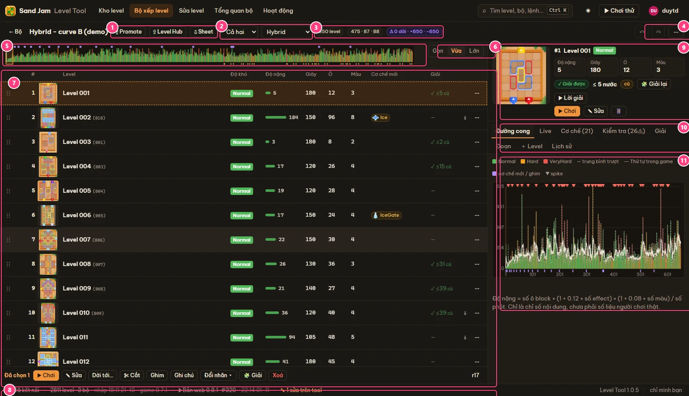

| # | Tính năng | Core |
| --- | --- | --- |
| 1 | ⇪ Promote (kiểm định trước: lỗi dữ liệu, trùng, special level, lệch lịch mở obstacle), ⇧ Level Hub, ⇩ Sheet (dữ liệu level ra Google Sheet của GD). | ✅ · Sheet ➕ |
| 2 | Nền tảng (Cả hai / Android / iOS) và segment của bộ. | ✅ · segment ➕ |
| 3 | Số level, số theo độ khó, Δ so với bộ đang ship (dời / thêm / bớt). | ➕ |
| 4 | Hoàn tác / làm lại, ⋯ menu cả bộ. | ✅ |
| 5 | Dải đường cong cả bộ: cuộn tới slot, thả slot đi xa; chấm tím là cơ chế mới hoặc slot ghim. | ➕ |
| 6 | Cỡ dòng Gọn / Vừa / Lớn. | ➕ |
| 7 | Bảng slot: kéo thả, `Alt+↑↓`, `Ctrl+X` / `Ctrl+V`, đổi variant bằng `[` `]`. Cột ảnh, tên (kèm tên gốc), độ khó, độ nặng, giây, ô, màu, cơ chế mới, Giải (⚠ khi không giải được). | ✅ kéo thả, dời, chọn nhiều · cột 🔌 `levelSummary` · cắt / dán, variant, cơ chế mới, Giải ➕ |
| 8 | Thanh slot đang chọn: Chơi, Sửa, Dời tới…, Cắt, Ghim, Ghi chú, Đổi nhãn độ khó hàng loạt, Giải, Xoá; revision của bộ. | ✅ Dời tới, Ghim · còn lại ➕ |
| 9 | Thẻ slot: ảnh, chỉ số, kết quả giải, ▶ Lời giải, Chơi, Sửa, 📱; các variant cùng họ để thay nhanh. | ✅ · lời giải, variant ➕ |
| 10 | Tab: Đường cong, Live, Cơ chế, Kiểm tra, Giải, Đoạn, ＋ Level, Lịch sử. | |
| 11 | Đường cong: độ nặng theo slot tô màu độ khó, trung bình trượt, spike, so với bộ khác. | ✅ · so bộ khác ➕ |

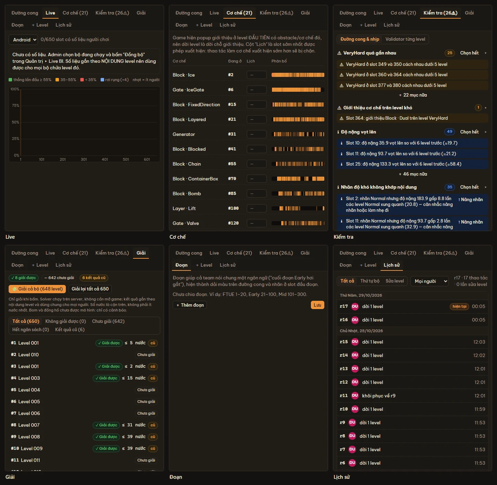

| Tab | Tính năng | Core |
| --- | --- | --- |
| Live | Thắng lần đầu và rơi rụng theo slot, lấy từ BI theo nền tảng. | ➕ |
| Cơ chế | Slot giới thiệu từng obstacle, cột Lịch (slot sớm nhất được phép xuất hiện), dải phân bố trong bộ. | ➕ |
| Kiểm tra | Đường cong và nhịp: VeryHard quá gần nhau, giới thiệu cơ chế trên level khó, độ nặng vọt lên, nhãn không khớp nội dung (Chọn hết, ↑ Nâng nhãn). Validator từng level. Xuất CSV. | ✅ validator cả bộ · quy tắc nhịp ➕ |
| Giải | Đếm giải được / chưa giải / kết quả cũ; Giải cả bộ; lọc không giải được, chưa giải, hết ngân sách, kết quả cũ. | ➕ |
| Đoạn | Đặt tên đoạn (FTUE 1-20, Early 21-100…), hiện thành dải màu trên đường cong và nhãn ở slot đầu đoạn. | ➕ |
| Lịch sử | Mọi thao tác trên bộ theo ngày, lọc thứ tự / sửa level / người; khôi phục bộ về một revision. | ✅ nhật ký · khôi phục bộ ➕ |

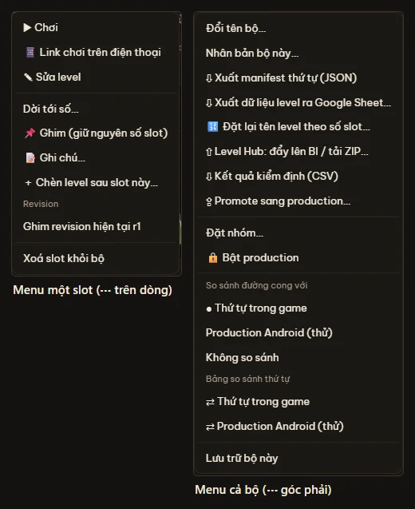

- **Menu slot**: Chơi, link điện thoại, Sửa, Dời tới số, Ghim, Ghi chú, Chèn level sau slot, Ghim revision hiện tại, Xoá
  slot khỏi bộ.
- **Menu bộ**: đổi tên, nhân bản, xuất manifest thứ tự (JSON), xuất ra Google Sheet, đặt lại tên level theo số slot, Level
  Hub, kết quả kiểm định (CSV), Promote, đặt nhóm, bật production, so sánh đường cong và bảng so sánh thứ tự với bộ khác,
  lưu trữ.
- Đoạn và lịch mở obstacle đang sửa dở không mất khi người khác xếp cùng bộ; ai vừa lưu bản khác thì tool hỏi trước khi ghi
  đè. ✅ khoá, revision · đoạn, lịch ➕

### Đẩy lên BI Level Hub

Mở từ **Bộ xếp level ▸ ⇧ Level Hub**. Ảnh tham chiếu đầy đủ, giữ nguyên giao diện Sand Jam, gồm tuỳ chọn kèm ảnh và thanh
nút dưới cùng:

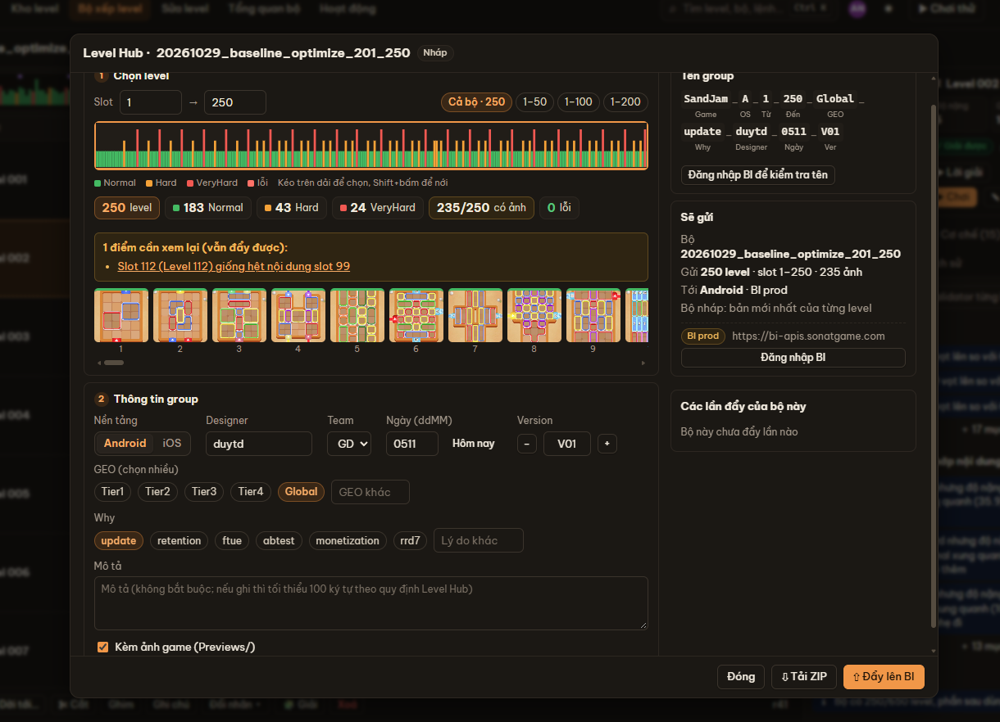

Trong ảnh: chọn 250 level, 235 level có ảnh, 0 lỗi; một cảnh báo trùng nội dung vẫn cho phép đẩy. Đây là trạng thái trong
ảnh tham chiếu, không phải kết quả vừa đẩy lên BI.

**Core đã có hộp đẩy trực quan theo bố cục Sand Jam**, cập nhật ngày 05/11/2026: chọn dải bằng số / nút nhanh / kéo,
thống kê độ khó, ảnh xem trước, thông tin group, kiểm tên và gợi ý version, tóm tắt và lịch sử đẩy. Nút **Kiểm tra** chốt
revision trước khi xuất hoặc đẩy; đổi tham số thì phải kiểm tra lại. Phần kèm ảnh game hiện chỉ có trên server Node.

Ảnh core thực tế dưới đây chụp vỏ dùng chung với game mẫu: 250 level, 236 ảnh PNG minh hoạ, BI giả chạy local; không
phải level Sand Jam hay kết quả đẩy lên BI thật. Giao diện sáng / tối và cửa sổ hẹp đã được kiểm tra.

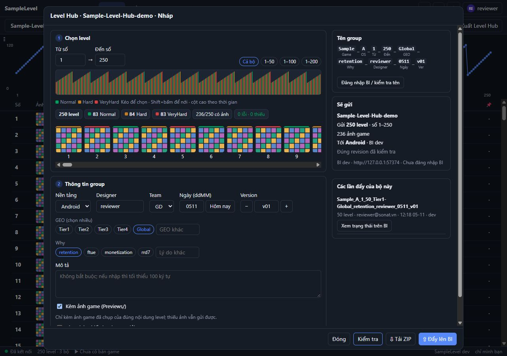

[Ảnh core khi cửa sổ hẹp, bố cục một cột](images/levelhub-core-narrow.jpg).

Ảnh demo có đánh số để tra bảng tính năng

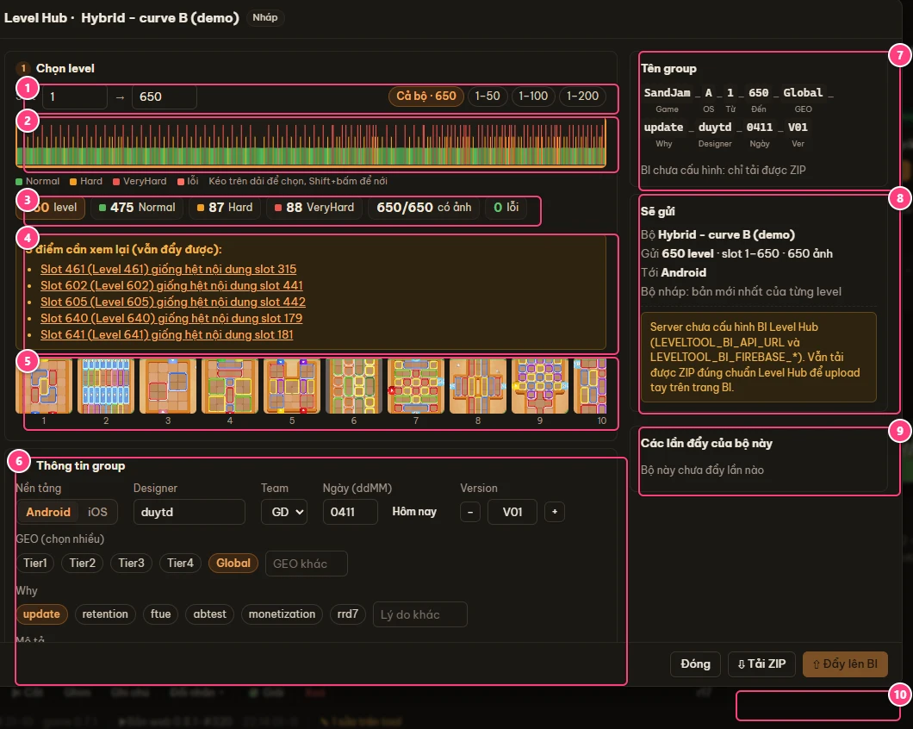

| # | Tính năng | Core |
| --- | --- | --- |
| 1 | Chọn dải slot: nhập số, hoặc Cả bộ / 1-50 / 1-100 / 1-200 / từng đoạn. | ✅ nhập dải số level và nút nhanh · chọn theo đoạn ➕ |
| 2 | Dải độ khó cả bộ: kéo để chọn slot, Shift + bấm để nới. | ✅ màu theo độ khó, cột cao theo thời gian từ hook game |
| 3 | Chip số level theo độ khó, số có ảnh, số lỗi, cập nhật theo dải đang chọn. | ✅ · số ảnh trên Node, thêm số level thiếu trong dải |
| 4 | Tách lỗi chặn đóng gói khỏi điểm cần xem lại; bấm mở level tương ứng. | ✅ validator, trùng nội dung, đang sửa, bản cũ đã kiểm tra · ghim revision từng slot production ➕ |
| 5 | Dải ảnh từng level sẽ gửi, cuộn ngang, nhãn số; tuỳ chọn Kèm ảnh game. | ✅ Node: ảnh capture raster đúng nội dung; không kèm ảnh sơ đồ / SVG |
| 6 | Nền tảng, designer, team, ngày / Hôm nay, version −/+, GEO chọn nhiều, Why, mô tả. | ✅ · Why và GEO có ô tuỳ nhập |
| 7 | Tên group 9 phần `Game_OS_From_To_GEO_Why_Designer_ddMM_Ver`, tô phần sai, kiểm tên trên BI và gợi ý version. | ✅ · core giữ định dạng version `v01`, tương thích API cũ `v1` |
| 8 | Cột Sẽ gửi: bộ, dải số, số level / ảnh, nền tảng, môi trường BI, revision đã kiểm tra, đăng nhập BI. | ✅ · chưa cấu hình BI vẫn tải ZIP được |
| 9 | Các lần đẩy của bộ này: tên group, số level, người đẩy, thời gian, môi trường, xem trạng thái. | ✅ · core bấm Xem trạng thái trên BI, rồi tự theo dõi khi PROCESSING |
| 10 | ⇩ Tải ZIP chuẩn Level Hub, ⇧ Đẩy lên BI bằng tài khoản BI của người bấm. | ✅ `LevelMetadata.json` + `Raw/<n>.json`; Node kèm `Previews/<n>.png|jpg|webp` |

**Bố cục và tương tác đã có trong hộp dùng chung của core:**

- Dùng một hộp thoại, không thêm màn hay tab. Bên trái đi theo hai bước **Chọn level → Thông tin group**; bên phải là
  **Tên group → Sẽ gửi → Các lần đẩy của bộ này**. Tên bộ dài được rút gọn để không đẩy lệch các nút.
- Sand Jam và core dùng hộp rộng tối đa 1060 px, không quá 96% chiều ngang cửa sổ; cột phải 300 px. Từ 860 px trở xuống
  chuyển thành một cột. Nội dung cuộn trong hộp; thanh **Đóng / ⇩ Tải ZIP / ⇧ Đẩy lên BI** luôn ở đáy hộp.
- Chọn dải bằng số, nút nhanh hoặc kéo đều cập nhật đồng thời dải màu, chip thống kê, cảnh báo, ảnh và tóm tắt gửi.
  Màu có chú giải Normal / Hard / VeryHard / lỗi, kèm chữ và số để đọc được cả khi không phân biệt màu.
- Ảnh xem trước cuộn ngang, tải khi cần, tối đa 300 ảnh rồi hiện số còn lại; thiếu ảnh có ô trống và số đếm rõ ràng.
  Bỏ **Kèm ảnh game** phải đổi số ảnh trong tóm tắt; thiếu ảnh không bị coi là lỗi level.
- Lỗi và cảnh báo có mức độ riêng; lỗi level chặn đẩy, cảnh báo vẫn cho đẩy. Tên group tách từng phần có nhãn; hiện rõ
  môi trường và tài khoản BI. Chưa cấu hình BI vẫn tải ZIP được; khi đang gửi khoá nút để tránh bấm lặp.

Khi làm cho game khác, dùng hộp core thay vì chép giao diện Sand Jam. Tên game, nhãn / chỉ số độ khó, mã obstacle và ảnh
lấy từ manifest, hook hoặc bridge của game. Core giữ **Kiểm tra → chốt revision → Xuất / Đẩy đúng bản đã kiểm tra**;
không tự lấy bản mới nhất khi người khác vừa sửa sau đó. Dải tối đa 20000 số, snapshot trùng hoặc chứa level đã xoá bị
chặn. Các bước chọn theo đoạn và ghim revision từng slot production vẫn là phần riêng của Sand Jam.

Nguồn đối chiếu: Sand Jam `app/js/views/levelhub.mjs`, `app/css/app.css` (nhóm `.hub-*`); core
`levelcore/web/js/levelhub.mjs` (hộp dùng chung), `levelcore/web/js/levelhub_model.mjs` (tiện ích thuần),
`levelcore/web/js/levelhub_bi.mjs`,
`levelcore/node/levelhub.mjs` và `levelcore/server/levelcore/levelhub.py` (nội dung gói ZIP).

## 4. Sửa level

Core dựng khung màn (danh sách, cột thông số, khung game, lưu, xung đột, lịch sử); bản đồ và công cụ là editor của game qua
hook `renderEditor`. Editor của Sand Jam là mẫu đầy đủ để tham khảo khi viết editor cho game mới.

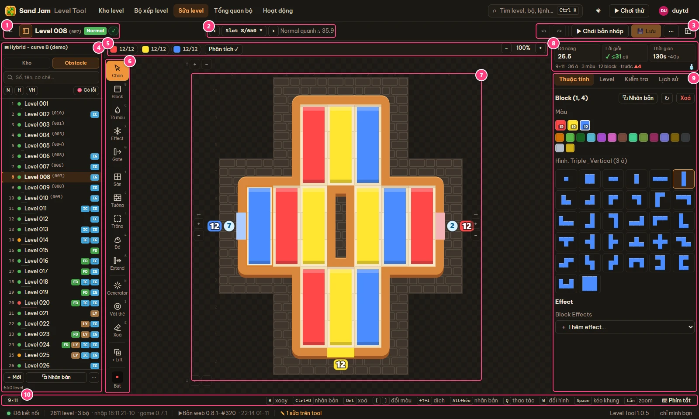

| # | Tính năng | Core |
| --- | --- | --- |
| 1 | ← quay lại, ☰ ẩn / hiện danh sách, tên level, nhãn độ khó, dấu hợp lệ. | ✅ |
| 2 | Mở từ bộ: slot trước / sau (`PageUp` / `PageDown`), nhảy slot, độ nặng các slot quanh đó. | ➕ |
| 3 | Hoàn tác / làm lại, ▶ Chơi bản nháp (chưa lưu vẫn chơi), 💾 Lưu (`Ctrl+S`, tự chụp lại ảnh), ⋯, bố cục. | ✅ |
| 4 | Danh sách level của bộ (`\`): Kho / Obstacle, tìm, lọc N / H / VH / có lỗi, nhãn màu obstacle bật tắt được; ＋ Mới, Nhân bản, đổi tên, xoá, sắp xếp. | ✅ · nhãn 🔌 `listItem` |
| 5 | Cân màu: số ô từng màu so với gate (12/12), lọc theo màu, đổi hoặc hoán đổi màu cả level; Phân tích ✓; zoom. | ➕ |
| 6 | Công cụ: Chọn, Block, Tô màu, Effect, Gate, Sàn, Tường, Trống, Đá, Extend, Generator, Vật thể, Xoá, + Lift, bút đang dùng. Thanh dọc hoặc dock gọn dưới lưới. | ➕ |
| 7 | Lưới 2D vẽ như game: kéo để đặt block liên tục, `Shift` + kéo lát kín vùng, `Alt` + bấm lấy mẫu, Ctrl + bấm chọn nhiều; ± ở 4 cạnh thêm / bớt hàng cột; số lượt băng, trạng thái valve vẽ trên hình. Con trỏ hiện icon công cụ. | ➕ |
| 8 | Dải số liệu: độ nặng (so slot trước), lời giải, thời gian (so ước lượng); kích thước, ô, màu, block, icon tính năng. | ➕ |
| 9 | Tab Thuộc tính / Level / Kiểm tra / Lịch sử, kéo tab sang trái hoặc phải lưới; chế độ tập trung `Ctrl+\`, kéo mép đổi độ rộng. | ✅ khung · nội dung 🔌 |
| 10 | Dòng gợi ý phím theo thao tác đang làm, ⌨ Phím tắt. | ✅ hook `shortcuts` |

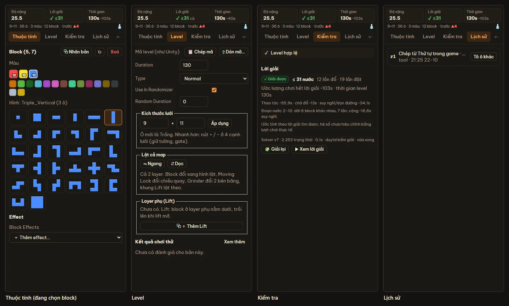

| Tab | Tính năng | Core |
| --- | --- | --- |
| Thuộc tính | Block đang chọn: màu (kèm số ô), hình (mọi hình block của game), effect của block; nhân bản, xoay, xoá. Panel tự sinh từ schema của game. Chọn nhiều block để đổi hình / màu / effect cả nhóm. | 🔌 |
| Level | Mã level như Copy / Paste của Level Editor Unity, duration, type, randomizer, kích thước lưới, lật cả map ngang / dọc (ra ảnh gương chơi như level gốc), layer phụ (Lift), kết quả chơi thử. Sửa special level: chế độ, level mở khoá, mục tiêu, chuỗi remote config. | ✅ form `fields` · còn lại ➕ |
| Kiểm tra | Validator, lời giải và ước lượng thời gian (thao tác, chờ đổ, suy nghĩ / dọn đường, đoạn dọn khó nhất); tự giải khi lời giải thiếu hoặc cũ; ▶ Xem lời giải. | 🔌 validator · solver ➕ |
| Lịch sử | Revision; so sánh (tô ô khác hoặc xem cạnh nhau), khôi phục. | ✅ · so bằng hình ➕ |

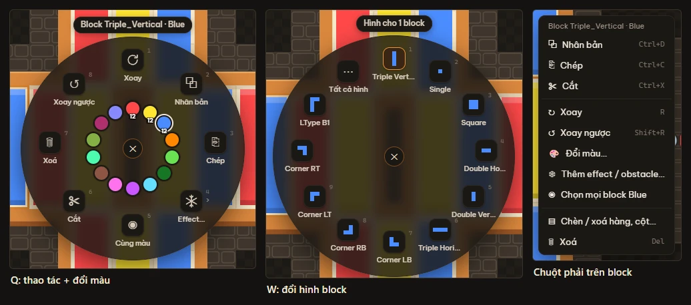

- `Q`: menu tròn ở con trỏ, thao tác (xoay, nhân bản, chép, effect, chọn cùng màu, cắt, xoá) và vòng đổi màu. ➕
- `W`: đổi hình block. ➕
- Chuột phải: nhân bản, chép, cắt, xoay, đổi màu, thêm effect / obstacle, chọn mọi block cùng màu, chèn / xoá hàng cột. ➕
- `R` xoay, `Shift+H` / `Shift+V` lật map; `Ctrl+C` khi không chọn gì là chép mã level, `Ctrl+V` mã từ Unity để thay cả
  level; chép dán block kèm effect sang level khác; `Shift+I` huy hiệu gate, bấm để phát lại các lượt kẹt ở gate đó. ➕
- Lưu trùng lúc người khác vừa lưu: so sánh hai bản, lưu thành bản sao, ghi đè hoặc tải bản mới. ✅

## 5. Tổng quan bộ

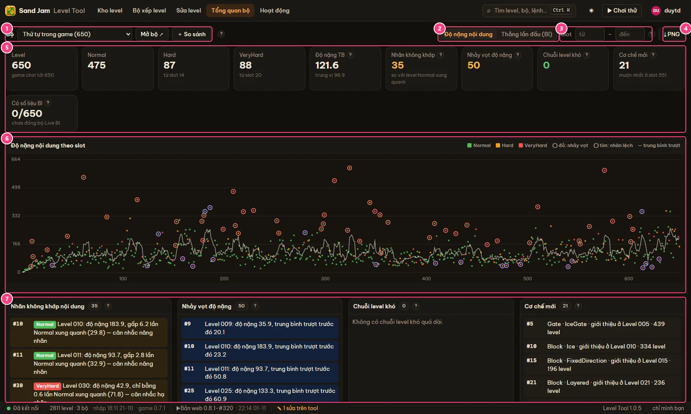

| # | Tính năng | Core |
| --- | --- | --- |
| 1 | Chọn bộ, Mở bộ, ＋ So sánh (tối đa 3 bộ). | ✅ |
| 2 | Tô theo độ nặng nội dung hoặc thắng lần đầu (BI). | ✅ · BI ➕ |
| 3 | Lọc khoảng slot. | ➕ |
| 4 | ⇩ PNG biểu đồ. | ➕ |
| 5 | Thẻ số: số level, theo độ khó (kèm slot Hard / VeryHard đầu tiên), độ nặng TB, nhãn không khớp, nhảy vọt, chuỗi level khó, cơ chế mới, có số liệu BI. | ✅ · cơ chế mới, BI ➕ |
| 6 | Biểu đồ độ nặng theo slot tô màu độ khó; vòng đỏ là nhảy vọt, vòng tím là nhãn lệch; trung bình trượt. | ✅ |
| 7 | Danh sách nhãn không khớp, nhảy vọt, chuỗi level khó, cơ chế mới; bấm một dòng mở đúng slot. | ✅ · cơ chế mới ➕ |

## 6. Hoạt động

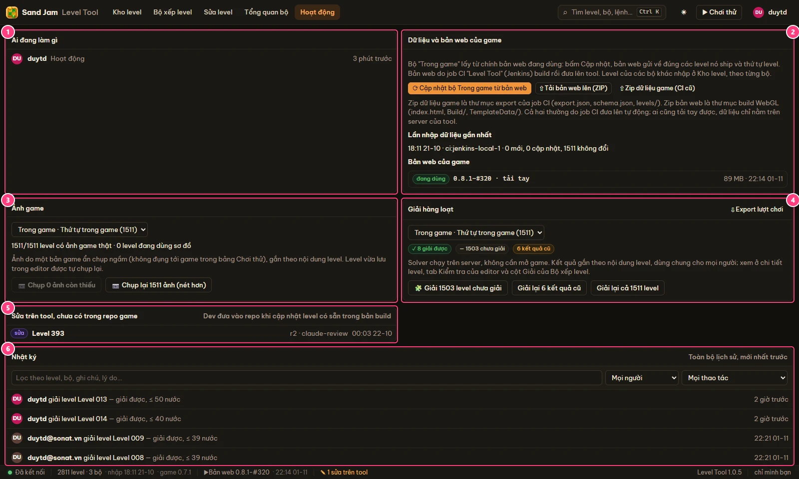

| # | Tính năng | Core |
| --- | --- | --- |
| 1 | Ai đang làm gì, ở màn nào. | ✅ |
| 2 | Dữ liệu và bản web của game: cập nhật bộ Trong game từ bản web, tải bản web (ZIP), zip dữ liệu game; lần nhập gần nhất; các bản web (giữ 3 bản, chọn bản đang dùng, xoá bản không dùng). | ✅ · cập nhật từ bản web ➕ |
| 3 | Ảnh game: số level có ảnh thật / đang dùng sơ đồ, chụp ảnh còn thiếu, chụp lại cả bộ. | ✅ · cần bridge chụp |
| 4 | Giải hàng loạt theo bộ; ⇩ Export lượt chơi. | Giải ➕ · export ✅ |
| 5 | Level sửa trên tool chưa có trong repo game (dev Pull về Unity). | ➕ |
| 6 | Nhật ký toàn bộ: lọc theo chữ, người, thao tác (lọc ở server, Xem thêm); "Xem thay đổi" cho từng lần lưu level. | ✅ |

## 7. Chơi thử

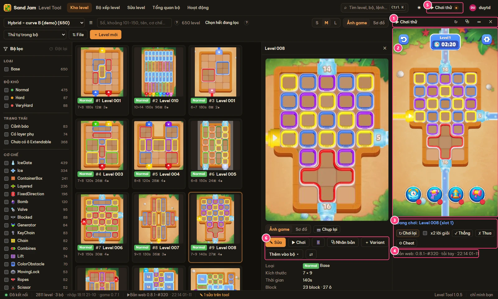

| # | Tính năng | Core |
| --- | --- | --- |
| 1 | ↻ tải lại game, ⧉ mở game ra cửa sổ riêng, ⇔ đổi độ rộng, ✕ đóng. Mỗi tab trình duyệt có game riêng. | ✅ |
| 2 | Game WebGL thật do CI build, chơi đúng level đang chọn, kể cả bản nháp chưa lưu. Bản web chỉ có gameplay (không Home, LiveOps; booster miễn phí). Game tạm dừng khi chuột rời khung để editor mượt. | ✅ khung · game viết bridge 🔌 |
| 3 | ↻ Chơi lại, x2 lời giải, ✓ Thắng, ✗ Thua, ⚙ Cheat. Thua có popup Revive như game, lượt revive ghi riêng. | ✅ · x2 lời giải ➕ |
| 4 | Bản web đang dùng (version, nguồn, giờ build). | ✅ |
| 5 | Nút ▶ Chơi thử trên thanh trên. | ✅ |
| 6 | ▶ Chơi có ở mọi nơi: thẻ level, chi tiết, menu slot, editor, `Ctrl+Enter` trong tìm nhanh. | ✅ |

- Thắng / thua, thời gian và nước đi báo về tool, lưu theo từng level; lượt cheat đánh dấu riêng. ✅
- ▶ Xem lời giải: tool gửi lời giải cho game, game restart và tự chơi từng nước ("bước 3/18"), ván đó tính là cheat. ➕
- 📱 Link điện thoại: quét QR là chơi đúng level đó, không cần đăng nhập. ✅

## 8. Quản trị và Thùng rác

| Quản trị | Thùng rác |
| --- | --- |
| 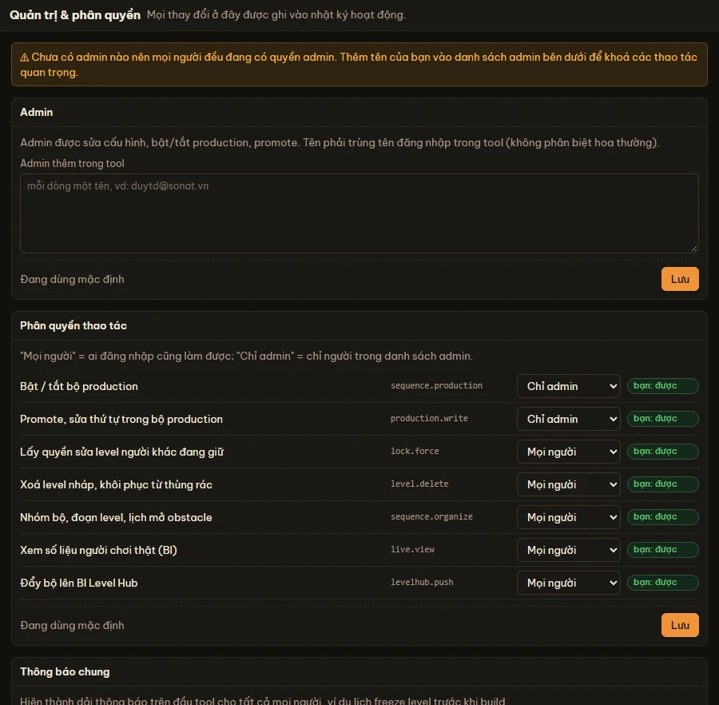 | 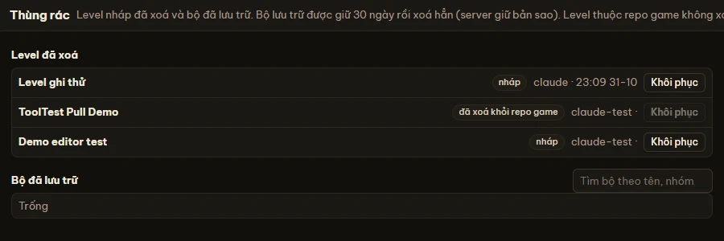 |

| Mục | Tính năng | Core |
| --- | --- | --- |
| Admin | Thêm admin trong tool (cộng với biến môi trường). Chưa có admin thì có cảnh báo. | ✅ |
| Phân quyền thao tác | Mọi người / Chỉ admin cho từng việc: bật production, promote, lấy quyền sửa người khác đang giữ, xoá / khôi phục, nhóm bộ và đoạn, xem Live BI, đẩy Level Hub. | ✅ · Live BI, đoạn ➕ |
| Thông báo chung | Dải thông báo đầu tool cho mọi người (vd lịch freeze level), tự ẩn theo giờ. | ✅ |
| Ngưỡng kiểm tra | Hard / VeryHard liên tiếp, khoảng cách giữa 2 VeryHard, giữa 2 lần giới thiệu cơ chế. | ➕ |
| Live BI | Bộ nào đang chạy thật cho Android / iOS, Đồng bộ. | ➕ |
| BI Level Hub | Mặc định tên group, team, GEO, lý do; mã obstacle. | ✅ · mã obstacle 🔌 |
| Hệ thống, Dung lượng | Cách đăng nhập, môi trường BI, app id, trạng thái key, sao lưu; tự dọn dữ liệu cũ. | ✅ |
| Thùng rác | Level nháp đã xoá và bộ đã lưu trữ (kèm lý do); khôi phục; tự xoá hẳn sau 30 ngày, ghi bản sao JSON trước khi xoá. | ✅ |

## 9. Chạy ngầm, không có màn riêng

| Tính năng | Mô tả | Core | Nguồn ở Sand Jam |
| --- | --- | --- | --- |
| Dữ liệu từ CI | Jenkins đẩy level (`export.json`, `schema.json`, `levels/`, `previews/`) và bản WebGL; nhập không ghi đè level đang sửa trên tool, báo xung đột. | ✅ hợp đồng CI v1 | `server/routes-ci.mjs`, `server/webgl.mjs` |
| Schema có sẵn | Tool kèm schema của game, deploy xong là tạo / nhập level được, không chờ CI. | 🔌 manifest | `server/seed/schema.json` |
| Ảnh level tự chụp | Một bản game ẩn chạy ngầm chụp bằng prefab và camera của game; lưu level là tự chụp lại; hàng đợi chạy tiếp sau khi tải lại trang; ảnh lớn cho chi tiết, ảnh nhỏ cho lưới. | ✅ · game viết bridge chụp | `app/js/capture.mjs`, `app/js/thumbs.mjs` |
| Solver | Weighted A\* viết bằng C#, chạy trên server bằng tiến trình .NET dùng chung lõi với game; hàng đợi trên server, mỗi nội dung chỉ giải một lần; kết quả theo sha nội dung, đánh dấu cũ khi đổi phiên bản solver. | ➕ ([ứng viên của core](KE-HOACH-CORE.md#7-phần-mở-rộng-nào-đáng-lấy-tiếp)) | `solver/`, `server/solver.mjs`, `server/solves.mjs` |
| Ước lượng thời gian | Từ lời giải: thời gian thao tác, chờ đổ, suy nghĩ / dọn đường (heuristic, chưa hiệu chỉnh bằng lượt chơi thật). | ➕ | `solver/Core/LevelSolverTimeEstimate.cs`, `app/js/solveview.mjs` |
| Lượt chơi | Mọi lượt chơi thử (bảng, link, Editor Unity, bản dev) ghi kèm nước đi để phát lại; chi tiết giữ 120 ngày, tóm tắt giữ mãi. | ✅ lưu, xuất JSONL · nhận từ Editor / bản dev ➕ | `core/playschema.mjs`, `server/plays.mjs`, `server/ingest.mjs` |
| Phân tích lượt chơi | Thời gian, thua đầu và nguyên nhân, gate gây chờ; đủ mẫu thì đề xuất giờ và nhãn khó. | ➕ | `core/playstats.mjs`, `app/js/insights.mjs` |
| Live BI | Đồng bộ số liệu người chơi thật hằng ngày bằng service account chỉ đọc, gắn theo nội dung level; level sửa sau khi đo ghi "live cũ". | ➕ | `server/livebi.mjs` |
| Production / Promote | Bộ production ghim revision từng slot; promote qua kiểm định; mặc định chỉ admin. | ✅ | |
| Level Hub | ZIP chuẩn `com.sonat.level.build`; đẩy bằng token BI của người bấm, server chỉ chuyển tiếp, không lưu. | ✅ | `server/levelhub.mjs` |
| Khoá sửa, xung đột | Khoá khi đang sửa, người khác thấy 🔒; lưu trùng thì so sánh / lưu bản sao / ghi đè. | ✅ | |
| Pull về Unity | Dev kéo level sửa trên tool vào asset đúng GUID trong repo game (menu Unity + token API). | ➕ | phía game |
| API cho agent | `GET /api/agent/*` chỉ đọc: digest level, đề xuất, timeline lượt chơi; skill `level-insights`. | ➕ | `server/agent.mjs` |
| Dọn dữ liệu | Hằng ngày xoá ảnh và kết quả giải của nội dung không còn dùng, lưu trữ timeline cũ. | ✅ | `server/housekeeping.mjs` |
| Đăng nhập | Firebase của BI, email `@sonat.vn`; chạy local thì gõ tên. | ✅ | |

Đường dẫn ở cột Nguồn tính từ gốc repo
[`sand-jam-level-tool`](https://github.com/SonatGameProduct/sand-jam-level-tool). Chi tiết từng tính năng và biến môi trường:
README của repo đó.

## 10. Gợi ý cho game mới

- Vỏ core (✅) đã đủ để GD làm việc: Kho level, Thứ tự, Tổng quan bộ, Hoạt động, Chơi thử, Level Hub, quyền, thùng rác.
- Viết sớm các hook 🔌 vì chúng làm vỏ core hiện đúng dữ liệu của game: `levelSummary` (cột, chỉ số, đường cong),
  `listFilters`, `validateLevel`, `thumbnail` (sơ đồ khi chưa có ảnh game), bridge WebGL (chơi thử, chụp ảnh). Các bước:
  [TICH-HOP-GAME.md](TICH-HOP-GAME.md).
- Phần ➕ lấy khi team có nhu cầu thật; ưu tiên theo [KE-HOACH-CORE.md mục 7](KE-HOACH-CORE.md#7-phần-mở-rộng-nào-đáng-lấy-tiếp).
  Thứ chung cho nhiều game (kiểm tra nhịp đường cong, đoạn, lịch mở cơ chế, so sánh 2 level) nên đóng góp về core thay vì
  chép riêng vào từng tool.
