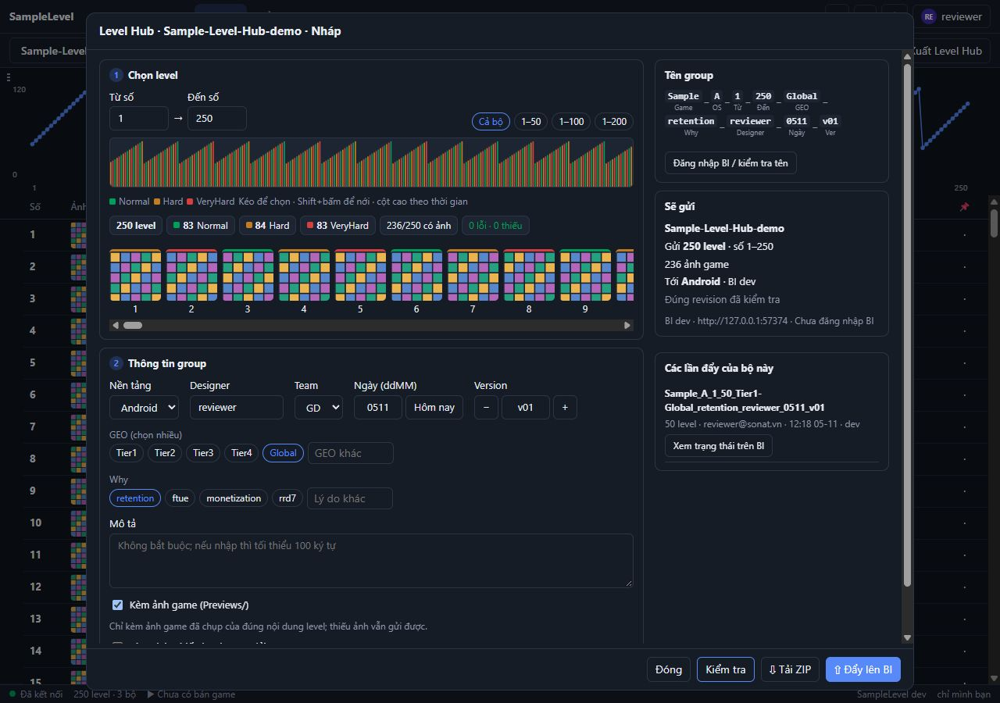

# Level Hub: kiểm tra core ngày 05/11/2026

Đối chiếu hộp đẩy Sand Jam và vỏ core. Kết quả dưới đây dùng game mẫu `contracts/sample`, dữ liệu tạm, BI giả local;
không đẩy lên BI dev / prod thật. Ảnh PNG ô màu là ảnh minh hoạ cho smoke, không phải ảnh capture của game thật.



[Bố cục một cột ở cửa sổ 780 × 900](images/levelhub-core-narrow.jpg).

## Kiểm tra giao diện

| Thao tác | Kết quả đã thấy |
| --- | --- |
| Thứ tự → Xuất Level Hub | Hai cột ở 1280 × 900; một cột ở 780 × 900; nội dung cuộn, thanh nút luôn ở đáy. |
| Mở bộ 250 level | 83 Normal, 84 Hard, 83 VeryHard, 236/250 có ảnh, 0 lỗi và 0 thiếu. |
| Chọn 1–50, thêm Tier1 cùng Global | Thống kê và tên / tóm tắt đổi đúng 50 level, 48 ảnh, GEO Tier1-Global. |
| Kéo trên dải | Chọn được số 30–82; Tải ZIP bị khoá cho tới khi kiểm tra lại. |
| Kiểm tra | Báo đã chốt 50 level; Tải ZIP và Đẩy lên BI được bật khi dữ liệu hợp lệ. |
| Bỏ Kèm ảnh game | Tóm tắt ghi Không kèm ảnh; phải kiểm tra lại. |
| Ghi mô tả dưới 100 ký tự | Chặn Đẩy lên BI; vẫn tải ZIP được. |
| Kiểm tên qua popup BI giả | Hiện Tên hợp lệ, chưa có trên BI; dùng token chỉ trong bộ nhớ. |
| Đẩy lên BI giả rồi xác nhận | PROCESSING hiện kèm tên group; lịch sử ghi 50 level, người đẩy, thời gian và môi trường dev. |
| Tải ZIP | Nhận file tên 9 phần; hộp vẫn mở, giữ revision đã kiểm tra. |
| Sáng / tối | Các phần đọc được ở cả hai chế độ; không có lỗi console trong lượt smoke. |

## Kiểm tra tự động

Chạy từ gốc repo:

```text
node levelcore/contracts/run.mjs
node --test levelcore/node/tests/*.test.mjs
cd levelcore/server
../../.venv/Scripts/python.exe -m pytest -q
```

Hợp đồng Level Hub kiểm cả Node và Python: giữ raw / metadata đúng snapshot khi head đổi; lỗi validator chặn xuất,
level thiếu cần xác nhận; cảnh báo trùng nội dung / đang sửa / bản cũ không chặn; ngày tuỳ chọn; tên trùng gợi ý version;
lỗi BI 401/403/409/413 giữ mã và gợi ý; mất phản hồi sau khi tạo thì tìm lại group; lịch sử theo bộ. Snapshot trùng,
level đã xoá, dải quá 20000 số và số không an toàn bị từ chối.

Riêng Node kiểm ảnh PNG đúng sha, loại SVG / ảnh nguồn render, bỏ ảnh khi tắt tuỳ chọn; sửa head làm mất ảnh ở bản mới,
xuất snapshot cũ vẫn kèm đúng ảnh cũ. Tiện ích thuần kiểm ngày Việt Nam, tên 9 phần, dải số thưa và chọn bằng vị trí kéo.

## Phạm vi còn khác Sand Jam

- Python chưa có kho ảnh game của Node: hộp báo không hỗ trợ ảnh, vẫn xuất raw / metadata và giữ luồng BI cũ.
- Core quản lý level theo số, chưa có đoạn và revision ghim riêng từng slot production như Sand Jam.
- Tên file raw của core giữ `<n>.json`, Sand Jam dùng `Level_NNN.json`; core giữ chuẩn version `v1` / `v01` hiện có.
- Chưa smoke bằng tài khoản BI thật hoặc build Unity thật; các bài BI ở đây đều dùng server giả.
