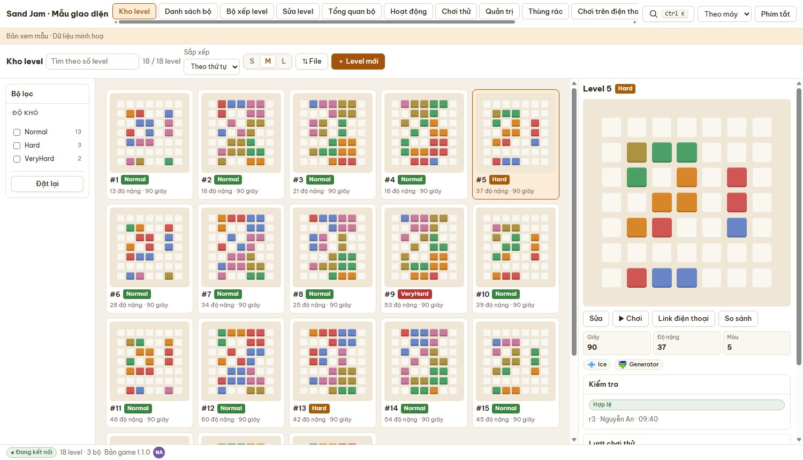
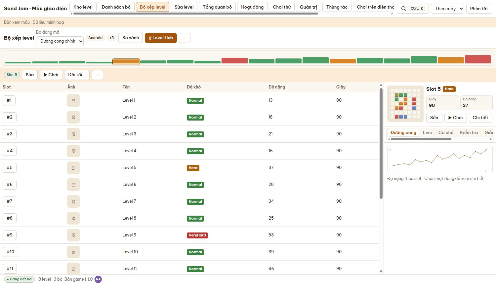
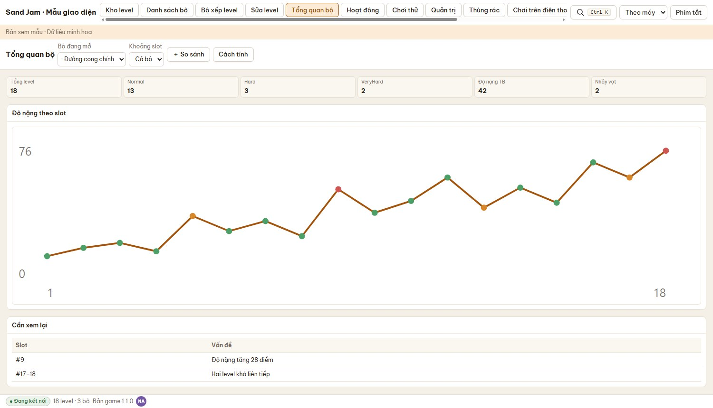
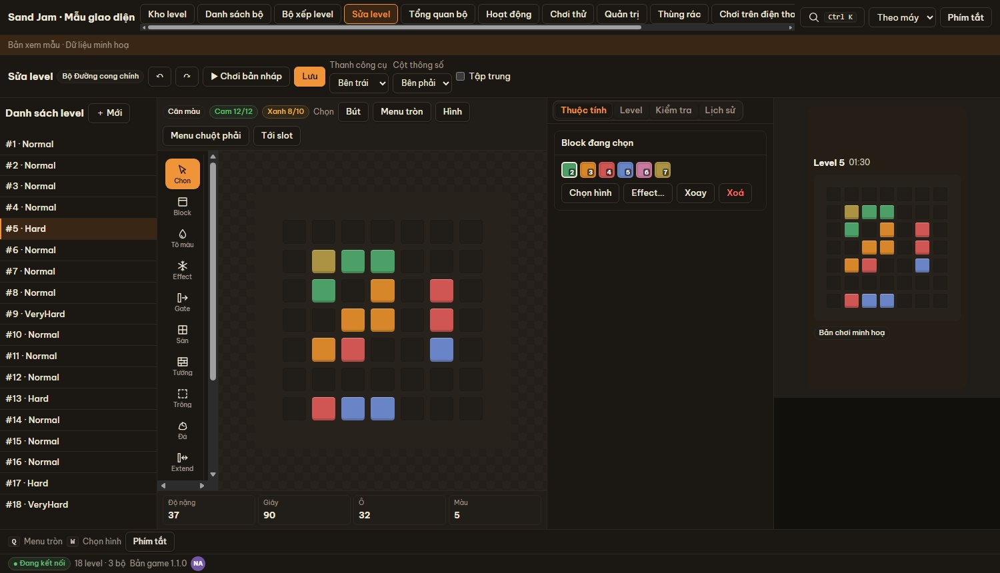
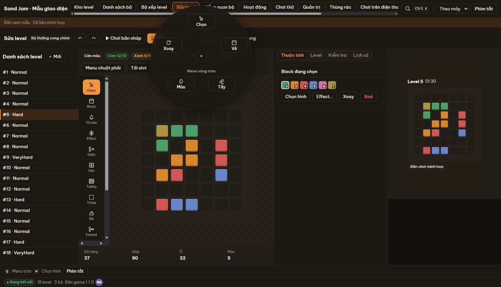
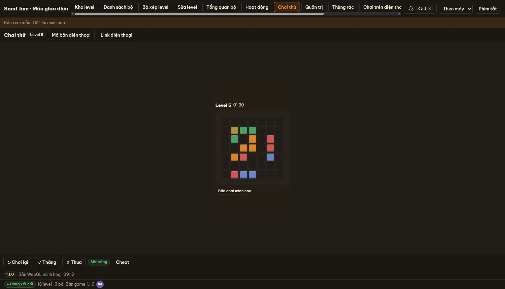
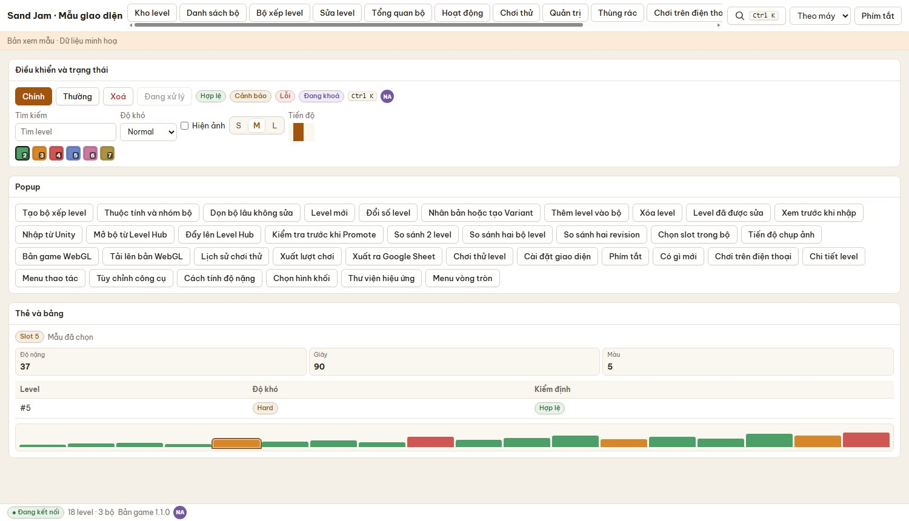
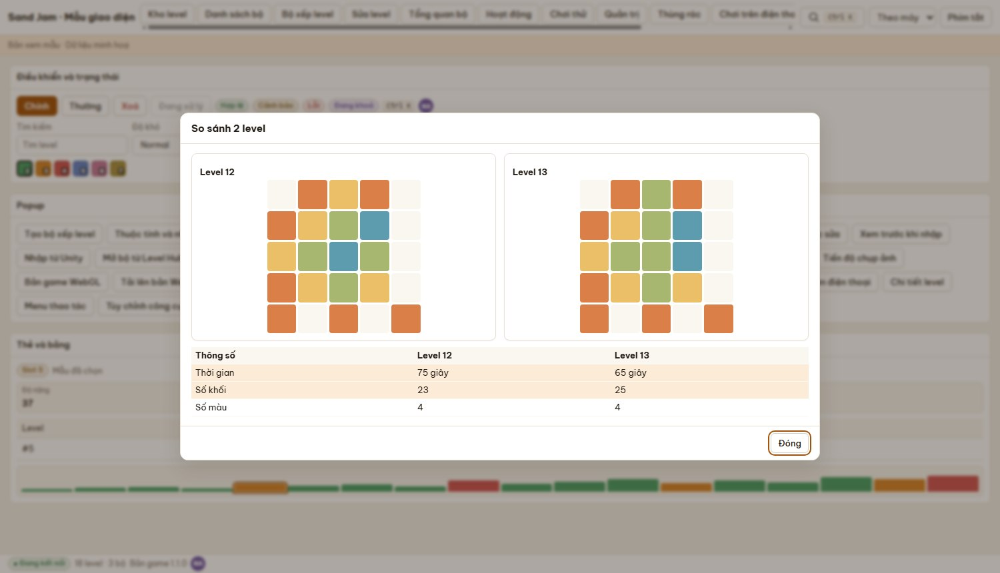
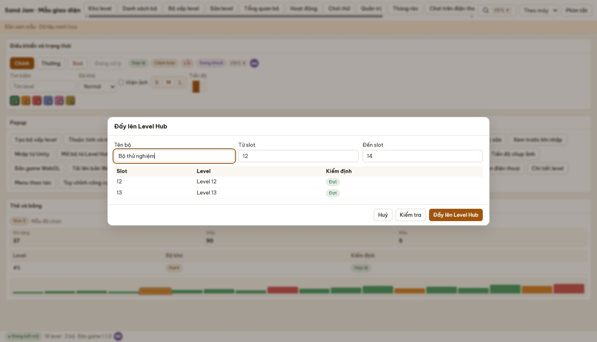

# Mẫu giao diện Sand Jam

`sand-jam` dùng tông cát–cam, font Be Vietnam Pro và các biểu tượng công cụ của Sand Jam. Mẫu gồm 12 bố cục lắp ghép,
36 ví dụ popup tương tác và các thành phần dùng chung như thẻ level, bộ lọc, bảng, tab, biểu đồ và nhãn trạng thái.

Ảnh trên trang này chụp từ bản xem mẫu chạy trên Level Tool Core với dữ liệu minh hoạ. Mở
[hướng dẫn chạy bản tương tác và bật `sand-jam` cho game khác](UI-TEMPLATES.md#dùng-các-phần-của-mẫu-sand-jam).

## Kho level và ngăn chi tiết

Bộ lọc ở trái, lưới ở giữa và ngăn xem ảnh, chỉ số, kiểm định, lịch sử ở phải. Thanh chọn nhiều xuất hiện khi chọn level.

## Bộ xếp level và Tổng quan bộ

Bố cục Bộ xếp level có dải điều hướng, bảng slot, thẻ slot đang chọn và vùng phân tích có tab. Tổng quan bộ có thẻ số liệu,
biểu đồ độ nặng theo slot và báo cáo cảnh báo.

## Editor và Chơi thử

Editor có danh sách level, thanh công cụ cạnh lưới hoặc dock bên dưới, cột thông số, dải chỉ số và khung Chơi thử.
Các bảng nổi cho bút, hình, hiệu ứng và menu tròn có thể gắn vào editor của từng game.

## Popup và thành phần UI

Các ví dụ bao gồm form, xác nhận, xem trước khi nhập, xung đột khi lưu, so sánh level hoặc revision, Level Hub,
tiến độ, phím tắt, QR và ngăn chi tiết. Các màn Đăng nhập, Danh sách bộ, Hoạt động, Quản trị, Thùng rác và Chơi trên điện
thoại cũng có trong bản tương tác.

## Dùng trong tool của game

Thêm `"uiTemplate": "sand-jam"` vào `game/manifest.json` để áp dụng kiểu hiển thị cho vỏ Core. Game có thể lắp từng bố
cục và popup vào màn riêng, rồi kết nối canvas, WebGL và dữ liệu của mình. [Danh sách bố cục và API](UI-TEMPLATES.md#dùng-các-phần-của-mẫu-sand-jam)
